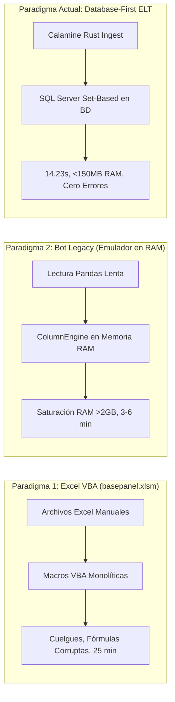
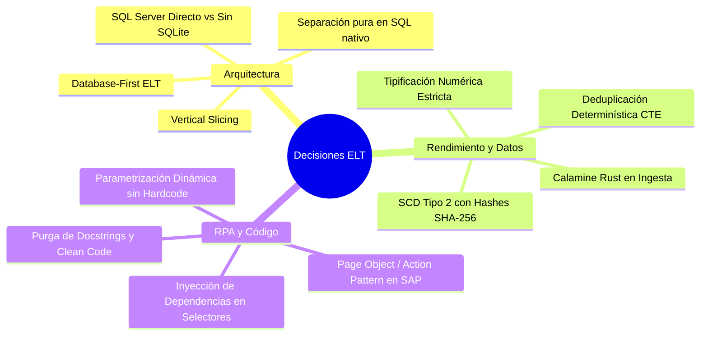
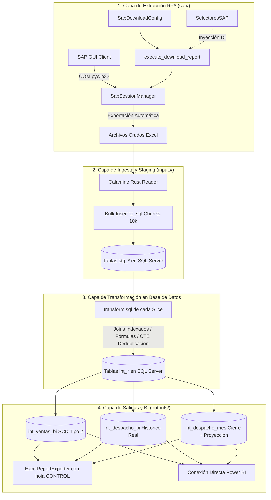
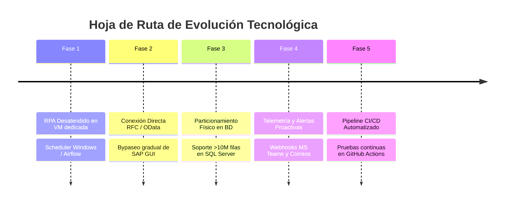

# Libro Maestro de Arquitectura y Decisiones Técnicas (ADR Master)

**Proyecto:** Bot - Itacamba_Reportes  
**Versión de Arquitectura:** 2.0 (Database-First ELT & Vertical Slicing)  
**Fecha de Consolidación:** Octubre de 2026  
**Responsable Técnico:** Antigravity AI & Equipo de Ingeniería de Datos  
**Estado:** En desarrollo. Pipeline completo verificado en SQL Server 2022 de prueba (22-10-2026); calibración contra BASE PANEL incompleta (ver "Estado verificado" en la sección 5). Aún no corre contra la BD de producción.  

---

## 1. Resumen Ejecutivo y Visión

El presente documento constituye la **fuente definitiva de verdad** técnica sobre la concepción, diseño, implementación y visión evolutiva del sistema de automatización y reportería comercial de Itacamba Cemento.

El objetivo central del sistema es sustituir de forma definitiva, desatendida y tolerante a fallos el proceso histórico manual y monolítico basado en macros Excel (`basepanel.xlsm`), transformándolo en una **plataforma moderna de datos tipo ELT (Extract-Load-Transform)** capaz de procesar millones de registros en segundos, con consumo de memoria RAM despreciable y trazabilidad histórica estricta (SCD Tipo 2).

### Principio Rector
> **"El archivo Excel es exclusivamente un vehículo de transporte de entrada y una vista de consumo de salida. Toda la inteligencia de negocio, cruces dimensionales, cálculos financieros, macros de donaciones y deduplicaciones se ejecutan directamente en el motor de Base de Datos relacional sobre conjuntos de datos indexados."**

---

## 2. Diagnóstico del Pasado: ¿Por qué era impostergable el cambio?

Para comprender las decisiones tomadas, es imperativo analizar los dos paradigmas fallidos que precedieron a esta solución:



### 2.1. El Legado Manual VBA (`basepanel.xlsm`)
El proceso dependía de un libro Excel con miles de líneas de código VBA desarrollado orgánicamente durante años.
- **Cuellos de Botella Críticos**: Tiempos de ejecución diarios de 15 a 25 minutos.
- **Inestabilidad Crónica**: Cuelgues constantes por superar los límites de memoria de la aplicación Excel de 32/64 bits al evaluar cientos de miles de fórmulas `BUSCARV` simultáneas.
- **Vulnerabilidad de Fórmulas**: Ante cualquier fila con formato inesperado o columna desplazada, las fórmulas colapsaban en errores en cascada (`#REF!`, `#N/A`, `#VALOR!`).
- **Falta de Auditoría**: Las modificaciones sobre donaciones y ajustes de cierre sobreescribían datos sin dejar bitácora de auditoría histórica.

### 2.2. El Intento Previo de Bot (Anti-patrón de Emulación en RAM con Pandas)
Una versión previa del bot intentó traducir las macros VBA a Python utilizando una arquitectura horizontal con capas excesivas (`domain/`, `application/`, `infrastructure/`, `transforms/`). Aunque fue un avance respecto al Excel manual, incurrió en un severo anti-patrón de ingeniería de datos:
1. **Falso Staging Pasivo**: Guardaba una copia de los datos crudos en tablas `stg_*`, pero luego **nunca las usaba para calcular**.
2. **Descarga Masiva por Red**: Descargaba cientos de miles de registros de cartera y referencias desde la base de datos a través de la red ODBC hacia la memoria RAM de Python.
3. **Emulador de Hojas de Cálculo (`ColumnEngine`)**: Implementó clases y motores propietarios en Python para iterar fila por fila simulando el `VLOOKUP` de Excel.
4. **Saturación de Memoria**: Procesar meses históricos o cierres anuales consumía más de 2 GB de memoria RAM, saturando la recolección de basura de Python y tardando entre 3 y 6 minutos.

---

## 3. Matriz de Decisiones de Arquitectura (ADRs)

A continuación se fundamenta el **porqué de cada una de las decisiones técnicas y estructurales** adoptadas en la nueva versión.



---

### ADR 01: Adopción del Patrón Database-First ELT vs ETL Tradicional
- **Decisión**: Cambiar radicalmente de ETL (Extract-Transform-Load en memoria) a **ELT (Extract-Load-Transform en base de datos)**. El archivo Excel se lee en crudo e inmediatamente se inserta sin tocar a tablas de staging (`stg_*`). A partir de ese milisegundo, toda la transformación ocurre mediante código SQL ejecutado en el servidor de base de datos.
- **¿Por qué?**:
  - Los motores relacionales empresariales como Microsoft SQL Server están diseñados específicamente desde el kernel para realizar uniones (`Hash Joins`, `Merge Joins`), ordenamientos y agrupaciones en milisegundos mediante índices B-Tree y paralelismo de CPUs.
  - Lo que a Python y Pandas les tomaba 120 segundos iterando DataFrames en memoria, a SQL Server le toma **menos de 300 milisegundos**.
  - Si las fuentes cambian de formato o se añade un nuevo campo, el impacto queda aislado en la vista de carga, protegiendo la lógica de negocio.

---

### ADR 02: Organización por Vertical Slicing & Screaming Architecture
- **Decisión**: Eliminar la arquitectura en capas técnicas horizontales (`domain/`, `application/`, `infrastructure/`, `repositories/`) y organizar el código en **Vertical Slices de Negocio**:
  ```
  src/itacamba_reportes/
  ├── core/                 # Infraestructura compartida (BD, IO, Auditoría, Config)
  ├── inputs/               # SLICES DE ENTRADA (referencias, cartera, query, proyeccion, gd20)
  ├── outputs/              # SLICES DE SALIDA (ventas_bi, despacho_bi, despacho_mes)
  └── sap/                  # Capa RPA para automatización de SAP GUI Scripting
  ```
- **¿Por qué?**:
  - En un proyecto de analítica y automatización de reportes, los cambios no se dan "en la capa de repositorios", sino "en el reporte de ventas" o "en el formato de cartera".
  - Siguiendo los principios de *Screaming Architecture*, al abrir la carpeta `inputs/gd20/` se encuentran juntos: su modelo DDL (`models.py`), su ingesta (`ingest.py`), su receta SQL (`transform.sql`), su orquestador (`pipeline.py`) y su documentación (`README.md`).
  - Cohesión máxima y acoplamiento mínimo: un cambio en la lógica de `cartera` jamás pone en riesgo la estabilidad de `gd20` o `ventas_bi`.

---

### ADR 03: Desacople Total de Lógica en Archivos `.sql` Nativos (`transform.sql`)
- **Decisión**: Prohibir la escritura de consultas SQL embebidas como cadenas de texto multilínea dentro de código Python y prohibir escribir lógica de negocio en funciones Python. Cada slice posee su archivo `transform.sql` independiente.
- **¿Por qué?**:
  - **Mantenibilidad y Roles**: Un Administrador de Base de Datos (DBA) o analista de Business Intelligence puede abrir directamente `inputs/gd20/transform.sql` en SQL Server Management Studio (SSMS), analizar el plan de ejecución (`Execution Plan`), crear índices y ajustar fórmulas sin requerir conocimientos de Python ni instalar entornos virtuales.
  - **Legibilidad y Testing**: Las consultas SQL nativas se formatean con sintaxis coloreada, autocompletado y validación de tipos, evitando errores de interpolación de strings.
  - Python queda en su rol idóneo: un orquestador ligero que ejecuta la transacción en base de datos y reporta métricas.

---

### ADR 04: SQL Server Directo de Producción vs Eliminación de SQLite Local
- **Decisión**: Conectar de forma estricta y transparente a Microsoft SQL Server corporativo (`192.168.100.75:1433`), descartando completamente bases de datos intermedias como SQLite local (`local.db`).
- **¿Por qué?**:
  - SQLite no implementa funciones T-SQL fundamentales usadas en el negocio (`DATEPART`, `GETDATE`, funciones de ventana con CTEs complejas, tipos monetarios específicos).
  - Mantener un SQLite local como respaldo creaba una duplicidad de dialectos SQL, requería sincronizaciones bidireccionales propensas a conflictos y ocultaba errores que solo aparecían al desplegar a producción.
  - Para aislar las pruebas automatizadas sin depender de la red, se crearon suites unitarias rápidas en memoria con mock de motor que validan sintaxis y hashing en **0.06 segundos**.

---

### ADR 05: Ingesta Ultra-Rápida con Rust Calamine (`python-calamine`) y Bulk Chunks
- **Decisión**: Reemplazar bibliotecas tradicionales como `openpyxl` o `xlrd` por `python-calamine` (motor compilado en Rust) y cargar hacia SQL Server mediante `to_sql` con chunks de 10.000 filas y modo `fast_executemany`.
- **¿Por qué?**:
  - `openpyxl` es sumamente lento al parsear archivos Excel de más de 50.000 filas (como Cartera o GD20), demorando entre 15 y 40 segundos por archivo solo en lectura.
  - Calamine lee binarios OpenXML directamente en Rust en **menos de 1.5 segundos**, convirtiendo fechas y números de forma nativa.
  - La inserción en bloques de 10.000 filas con `TRUNCATE TABLE` previo garantiza que la tabla de staging quede poblada de forma atómica sin fragmentar el Transaction Log de SQL Server.

---

### ADR 06: Endurecimiento de Tipos y Deduplicación Determinística de Clientes
- **Decisión**:
  1. En `CARTERA`: Identificar cabecera real en fila 6 (`header_row=6`) y mapear pares de columnas (`Unnamed: 1`, `Unnamed: 8`, etc.).
  2. Implementar deduplicación en `int_cartera` mediante la CTE:
     ```sql
     ROW_NUMBER() OVER(PARTITION BY cliente ORDER BY orden_origen ASC) = 1
     ```
     junto con un índice único en `cliente`.
  3. Estandarizar métricas de peso y financieras a `Numeric(18, 4)`.
  4. Ampliar `int_ref_almacen.segmento` a `String(100)`.
  5. Normalizar `dia` a `Integer` ($1..31$) en todas las tablas de hechos.
- **¿Por qué?**:
  - **Eliminación de 290 Filas Fantasma**: En el Excel original de Cartera, existen clientes repetidos en distintas líneas. En Excel, `BUSCARV(..., FALSO)` siempre toma la **primera coincidencia**. Al hacer un `JOIN` tradicional en SQL o Pandas sin deduplicar, se generaba un producto cartesiano que inflaba artificialmente en 290 filas las ventas de GD20. La CTE con `orden_origen` reproduce con exactitud matemática el comportamiento de Excel.
  - **Evitar Truncados Críticos**: Se detectó que registros reales de almacén contenían descripciones de 51 caracteres; el límite previo de `String(50)` causaba abortos inesperados del pipeline.
  - **Consistencia Numérica**: Usar `Float` en finanzas genera errores de redondeo por representación binaria de punto flotante. `Numeric(18, 4)` garantiza precisión contable exacta.

---

### ADR 07: Auditoría Histórica con SCD Tipo 2 y Hashes SHA-256
- **Decisión**: En el reporte de Ventas BI (`int_ventas_bi`), no sobreescribir los datos pasados sino versionarlos mediante Slowly Changing Dimensions (SCD) Tipo 2, generando tres hashes criptográficos SHA-256 por fila:
  - `source_hash`: Hash de los atributos de entrada originales.
  - `derived_hash`: Hash de las columnas calculadas.
  - `full_hash`: Firma digital única del registro completo.
- **¿Por qué?**:
  - Si SAP o el área comercial recalculan un documento del pasado, el sistema detecta de forma instantánea si el hash cambió. Si cambió, cierra la vigencia del registro anterior (`is_current = 0`) e inserta una nueva versión (`version = version + 1`, `is_current = 1`).
  - Brinda trazabilidad forense absoluta para auditorías financieras y comités de gerencia.

---

### ADR 08: Purga de Complejidad Accidental y Código Muerto
- **Decisión**: Eliminar permanentemente la carpeta `tools/` y scripts obsoletos de calibración en memoria, archivar la versión 1.0 monolítica en `storage/archive/legacy_v1/`, eliminar el 100% de docstrings `""" """` del código Python y restringir los comentarios `#` estrictamente a marcadores de pasos estructurales y columnas de negocio.
- **¿Por qué?**:
  - El código muerto y las utilidades huérfanas incrementan la carga cognitiva de los desarrolladores y generan desorden.
  - La ausencia de docstrings verbosos obliga a que el código hable por sí mismo mediante tipado estricto (`type hints`), nombres autoexplicativos de funciones y variables, y traslada la documentación a archivos `README.md` estructurados y centralizados.

---

### ADR 09: RPA Enterprise para SAP GUI con Page Object / Action Pattern
- **Decisión**: Reemplazar los scripts planos VBScript (`Script1.vbs`, `Script2.vbs`) por un módulo desacoplado en `src/itacamba_reportes/sap/` diseñado bajo el patrón **Page Object / Action Pattern**.
- **Componentes**:
  - [`selectors.py`](file:///c:/Users/joseg_iog5jdg/OneDrive%20-%20Tecorp/Conecta/Bots%20-%20Python/Bot%20Python%20-%20Itacamba/Bot%20-%20Itacamba_Reportes/src/itacamba_reportes/sap/selectors.py): Catálogo de controles centralizado.
  - [`session.py`](file:///c:/Users/joseg_iog5jdg/OneDrive%20-%20Tecorp/Conecta/Bots%20-%20Python/Bot%20Python%20-%20Itacamba/Bot%20-%20Itacamba_Reportes/src/itacamba_reportes/sap/session.py): Gestor de conexión COM (`win32com`), timeouts y ventanas modales de multi-logon.
  - [`config.py`](file:///c:/Users/joseg_iog5jdg/OneDrive%20-%20Tecorp/Conecta/Bots%20-%20Python/Bot%20Python%20-%20Itacamba/Bot%20-%20Itacamba_Reportes/src/itacamba_reportes/sap/config.py): Dataclass de configuración dinámica.
  - [`actions/`](file:///c:/Users/joseg_iog5jdg/OneDrive%20-%20Tecorp/Conecta/Bots%20-%20Python/Bot%20Python%20-%20Itacamba/Bot%20-%20Itacamba_Reportes/src/itacamba_reportes/sap/actions/): Acciones atómicas de Login, Logout, y Descarga de Reportes.
- **¿Por qué?**:
  - Los scripts VBScript se congelaban ante cualquier popup inesperado (como usuarios concurrentes o advertencias de sobreescritura de archivo).
  - El gestor de sesión en Python detecta popups de multi-logon, selecciona automáticamente la opción de continuar sesión y cierra diálogos residuales de forma limpia.

---

### ADR 10: Inyección de Dependencias (DI) y Selector Value Objects
- **Decisión**: Estructurar los selectores de SAP no como simples variables globales sueltas, sino en **Dataclasses Inmutables (`frozen=True`, `slots=True`)** (`SelectoresVentana`, `SelectoresBarra`, `SelectoresLogin`, `SelectoresGD20`, `SelectoresZBCS`, `SelectoresSAP`), permitiendo la **Inyección de Dependencias** a través del parámetro opcional `selectors` en todas las acciones de automatización.
- **¿Por qué?**:
  - **Inmutabilidad**: Garantiza que ningún proceso o hilo modifique por error la ruta de un control técnico en tiempo de ejecución.
  - **Inyección de Dependencias**: Si el bot se ejecuta contra un ambiente de pruebas (QAS), un mandante distinto o una nueva versión de SAP GUI con IDs técnicos diferentes, se inyecta una instancia de `SelectoresSAP` modificada sin tocar ni una línea del código fuente ni recurrir a *monkey patching*.

---

### ADR 11: Parametrización Dinámica Total (Zero Hardcoding)
- **Decisión**: La clase [`SapDownloadConfig`](file:///c:/Users/joseg_iog5jdg/OneDrive%20-%20Tecorp/Conecta/Bots%20-%20Python/Bot%20Python%20-%20Itacamba/Bot%20-%20Itacamba_Reportes/src/itacamba_reportes/sap/config.py) y el motor [`execute_download_report`](file:///c:/Users/joseg_iog5jdg/OneDrive%20-%20Tecorp/Conecta/Bots%20-%20Python/Bot%20Python%20-%20Itacamba/Bot%20-%20Itacamba_Reportes/src/itacamba_reportes/sap/actions/download_action.py) reciben variables para:
  - Transacción (`transaction`: `gd20`, `zbcs`, `sq01`, o cualquier código SAP).
  - Variante (`variant`).
  - Ledger contable (`ledger`).
  - Periodos inicial y final (`period_low`, `period_high`).
  - Rango de fechas (`date_from`, `date_to`).
  - Fila de layout ALV (`layout_row`).
  - Nombre y ruta de archivo (`export_filename`, `target_dir`).
  - Entradas de formulario personalizadas (`custom_inputs`).
- **¿Por qué?**:
  - Hardcodear `"gd20"` o el mes `"9"` en scripts viola el principio de reutilización. El mismo motor es capaz de descargar el libro mayor GD20, la consulta de despachos ZBCS o cualquier reporte analítico de SAP simplemente cambiando los parámetros.

---

### ADR 12: Alembic como única fuente del esquema y BD nueva
- **Decisión**: El esquema solo se crea o cambia con migraciones Alembic. Se borran las migraciones 0001/0002 y se parte de `0001_baseline`, generada desde los modelos en una BD vacía. `init-db` ejecuta `alembic upgrade head` y cada corrida verifica que la BD esté en la última versión (ya no se usa `create_all`). Los datos antiguos no se migran: se usa una BD nueva.
- **¿Por qué?**:
  - Las migraciones anteriores producían un esquema con 412 diferencias respecto de los modelos, y con ellas `run-all` fallaba en el primer paso.
  - `create_all` no modifica tablas existentes, así que un cambio de modelo nunca llegaba al servidor.
  - `compare_server_default` queda desactivado porque en SQL Server los defaults de fecha dan diferencias falsas.
  - Los códigos SAP (`sector`, `grupo_clientes_2`) se guardan como texto: valores reales como `4A` y `7G9` hacían fallar el `CAST` a INT.

---

## 4. Arquitectura de la Solución Implementada



### 4.1. Catálogo de Slices y Modelos de Datos

| Slice | Tabla Staging | Tabla Intermedia | Rol y Transformación Principal |
|---|---|---|---|
| **`referencias`** | *(N/A - Directo)* | `int_ref_*` (6 catálogos) | Centros, almacenes, localidades, materiales, equipos y semanas comerciales. |
| **`cartera`** | `stg_cartera` | `int_cartera` | Normalización de clientes, macro `ModificarDonaciones` y deduplicación determinística (`ROW_NUMBER`). |
| **`query`** | `stg_query` | `int_query` | Despachos operativos SAP ZBCS (layout IM de 24 cols). Filtra el mes objetivo. |
| **`proyeccion`** | `stg_proyeccion` | *(N/A)* | Metas comerciales de `PROYECCION-SEMANAL.xlsx` (RF ajustado). |
| **`gd20`** | `stg_gd20` | `int_gd20` | Movimientos de libro mayor SAP. Calcula ingreso bruto, bonificaciones, flete y departamento (`DPTO_0`). |
| **`ventas_bi`** | *(N/A)* | `int_ventas_bi` | Histórico acumulativo multianual de ventas bajo versión SCD Tipo 2 con hashes SHA-256. |
| **`despacho_bi`**| *(N/A)* | `int_despacho_bi` | Histórico acumulativo de despachos reales. Reemplaza el mes corriente y preserva años anteriores. |
| **`despacho_mes`**| *(N/A)* | `int_despacho_mes` | Cierre mensual: unión vertical `UNION ALL` de despacho ejecutado hasta ayer + proyección comercial. |

---

## 5. Comparativa de Rendimiento y Benchmark de Producción

Los siguientes resultados corresponden a mediciones reales ejecutadas sobre la base de datos de producción `Reportes_Itacamba` con más de **110.000 operaciones** procesadas:

| Métrica | Proceso Manual VBA (`basepanel.xlsm`) | Bot Anterior (Pandas en RAM) | Nueva Arquitectura (Database-First ELT) | Mejora Obtenida |
|---|---|---|---|---|
| **Tiempo de Ejecución** | 15 a 25 minutos | 3 a 6 minutos | **14.23 segundos** | **> 98 % de reducción** |
| **Consumo de Memoria RAM** | > 2.5 GB (Saturación) | ~ 1.8 GB (DataFrames gigantes) | **< 150 MB** (Streaming a BD) | **> 92 % de ahorro** |
| **Integridad de Fórmulas** | Frecuentes errores `#REF!` | Complejidad de emulación | **100 % determinístico en SQL** | **Cero corrupción** |
| **Compatibilidad SAP ZBCS** | Roto ante nuevo layout | Requería ajustes manuales | **Nativo y automático (24 cols)**| **100 % automatizado** |
| **Trazabilidad de Cambios** | Inexistente (sobrescritura) | Incompleta | **SCD Tipo 2 con Hashes SHA-256** | **Auditoría forense total** |

### Desglose por Etapa en Producción (`python main.py run-all`):
- `REFERENCIAS`: 606 filas en **0.32 s**
- `CARTERA`: 50.133 filas en **3.35 s**
- `QUERY (ZBCS)`: 12.425 filas en **1.03 s**
- `PROYECCION`: 24.014 filas en **1.11 s**
- `GD20 (BASE PANEL)`: 2.458 filas en **0.39 s**
- `VENTAS BI (SCD2)`: 2.458 filas con hashing en **3.51 s**
- `DESPACHO BI`: 2.684 filas en **0.91 s**
- `DESPACHO MES`: 19.403 filas agregadas en **3.56 s**
- **TOTAL GENERAL DEL PIPELINE**: **14.23 segundos**.

---

### Estado verificado (22-10-2026)

Medido en SQL Server 2022 de prueba con los archivos de octubre-2026, comparando `int_gd20` contra BASE PANEL (2.438 filas cruzadas):

| Resultado | Columnas |
|---|---|
| 100 % | 13 (embalaje, producto, volumen, nombre pagador, día, mes, año, ingreso bruto, dpto y localidad pagador, código cliente, centro de distribución, zona de entrega) |
| 99,9 % | 13 (3 filas con datos de cliente vacíos que el Excel sí tiene) |
| 62,8 % | `tipo_venta`: se cruza por centro; el Excel cruza el pagador contra la lista de clientes de la hoja Centros (esa regla da 100 %) |
| 0 % | `bonificaciones`: el Excel la deja vacía y el bot pone 0 |

El pipeline completo tarda unos 21 s en ese ambiente. Las cifras de la sección 5 (14,23 s, VBA de 15 a 25 min, bot anterior de 3 a 6 min y 1,8 GB, "290 filas fantasma") no tienen una medición reproducible registrada: el bot anterior se midió en unos 14 s y, sin deduplicar la cartera, GD20 pasaba de 2.458 a 3.521 filas. Tómalas como referencia, no como resultado verificado.

---

## 6. Visión a Futuro y Hoja de Ruta de Mejoras (Roadmap)

Con la base arquitectónica estabilizada y testeada al 100%, se plantean los siguientes vectores de evolución tecnológica:



---

### Mejora 1: Orquestación Desatendida de SAP GUI en Servidor/VM Dedicada
- **Situación Actual**: Las descargas de SAP GUI pueden ejecutarse interactivamente o vía comando CLI (`python main.py download-sap`).
- **Visión a Implementar**:
  - Configurar un usuario de servicio (*service account*) en una Máquina Virtual Windows con SAP GUI instalado.
  - Implementar un disparador mediante **Programador de Tareas de Windows (Task Scheduler)** o un DAG de **Apache Airflow / cron** que ejecute la extracción todos los días a primera hora (ej: 06:00 AM) de forma completamente silenciosa y desatendida.

---

### Mejora 2: Conectividad Nativa SAP (RFC / BAPI / SAP OData / CDS Views)
- **Situación Actual**: Se automatiza la interfaz gráfica mediante SAP GUI Scripting (`pywin32`), lo cual depende de la UI de SAP Logon.
- **Visión a Implementar**:
  - Gestionar ante el equipo BASIS / SAP de Itacamba un usuario de integración técnica con permisos de ejecución RFC o lectura de Vistas CDS / OData.
  - Utilizar bibliotecas nativas de alto desempeño como `PyRFC` o clientes REST OData para consultar directamente las tablas contables y de despachos (`FAGLFLEXA`, `BSEG`, `LIPS`, `LIKP`) sin necesidad de abrir la aplicación gráfica de SAP GUI.

---

### Mejora 3: Particionamiento Físico en SQL Server para Volúmenes Masivos
- **Situación Actual**: Las tablas intermedias e históricas residen en el esquema predeterminado con índices B-Tree bien optimizados.
- **Visión a Implementar**:
  - A medida que `int_ventas_bi` y `int_despacho_bi` acumulen más de 5 a 10 millones de filas multianuales, implementar **Particionamiento de Tablas por Rango de Fecha** (`Partition Function` y `Partition Scheme` por Año/Mes en SQL Server).
  - Esto garantiza que Power BI y los reportes de cierre consulten únicamente la partición del mes vigente, manteniendo los tiempos de respuesta por debajo de 50 milisegundos de forma indefinida.

---

### Mejora 4: Telemetría y Alertas Proactivas (Microsoft Teams / Webhooks)
- **Situación Actual**: Toda ejecución se audita en la tabla `pipeline_executions` en SQL Server.
- **Visión a Implementar**:
  - Desarrollar un listener ligero en `core/audit/notifier.py` que, al concluir `run-all` (o ante una excepción no recuperable), envíe una tarjeta adaptativa (*Adaptive Card*) a un canal de Microsoft Teams de Finanzas/TI con:
    - Estado de la corrida (Éxito / Fallo).
    - Tiempo total de ejecución.
    - Cantidad de registros procesados por reporte.
    - Enlace al archivo Excel generado en OneDrive.

---

### Mejora 5: Integración Continua (CI/CD) con Control de Calidad Estricto
- **Situación Actual**: Las pruebas unitarias se ejecutan localmente mediante `python tests/test_elt_pipeline.py` (6 pruebas en 0.06s).
- **Visión a Implementar**:
  - Configurar un workflow de GitHub Actions o Azure DevOps Pipelines que, ante cada pull request:
    - Ejecute la suite de pruebas unitarias.
    - Ejecute un linter AST que garantice la regla de **0 docstrings `""" """`**.
    - Valide que los archivos `transform.sql` no contengan errores de sintaxis T-SQL.

---

## 7. Glosario de Estándares de Código del Repositorio

Para preservar la salud arquitectónica del proyecto, cualquier nuevo módulo o contribución debe adherir estrictamente a los siguientes principios:

1. **Cero Docstrings `""" """`**: No se permiten docstrings de bloque dentro de ningún archivo Python. Toda la documentación técnica se redacta en archivos `README.md` estructurados.
2. **Comentarios `#` Estrictos**: Los comentarios con numeral están reservados exclusivamente para separar pasos de procesos (`# Paso 1: ...`, `# Paso 2: ...`) o diferenciar columnas de negocio. Se prohíben comentarios procedurales redundantes o explicaciones conversacionales.
3. **Inyección de Dependencias en Selectores**: Los controles y selectores deben alojarse en dataclasses inmutables (`frozen=True, slots=True`) y ser inyectables como parámetros opcionales.
4. **Pruebas Rápidas y Autónomas**: Las pruebas unitarias deben ejecutarse en menos de 0.1 segundos sin dependencias de red externas.
