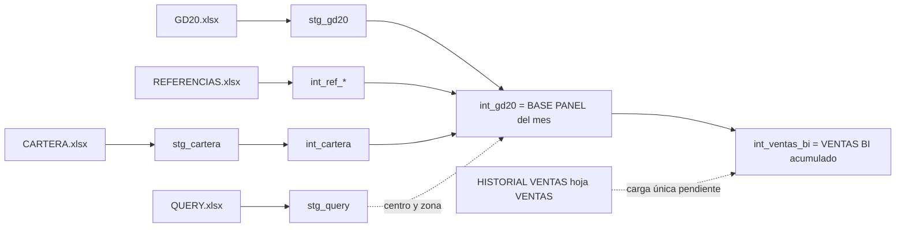
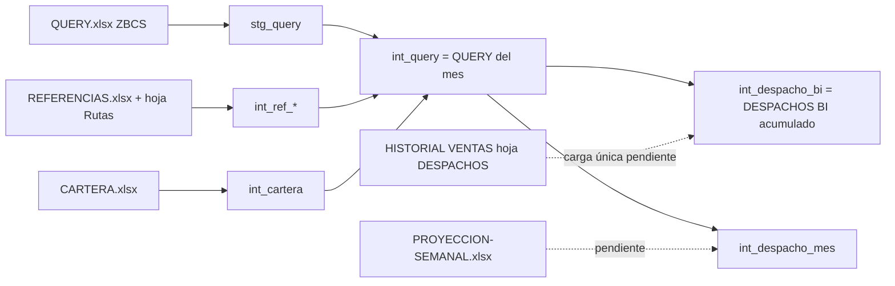

# Flujo de datos: de los Excel a VENTAS BI y DESPACHO BI

> **Aviso (22-10-2026):** las columnas "En el bot" y "Estado" de las tablas V1–V11 y D1–D7 describen la versión anterior del bot (`reports/`, `domain/joins.py`, `center_overrides.py`), hoy archivada en `storage/archive/legacy_v1`. Siguen vigentes la sección 1 (puntos de control), las columnas "En el Excel" y la tabla 3.1. El estado actual de PC3 está en `DECISIONES_ARQUITECTURA_ELT.md`, sección "Estado verificado".

Este documento muestra qué hace el `basepanel.xlsm` paso a paso, qué hace el bot en cada paso y qué falta para que el resultado coincida al 100 %. Es la guía para calibrar: si un número no coincide, se busca en qué paso se separan.

## 1. Regla de oro para mejorar sin romper

El bot puede calcular **distinto** (más rápido, más ordenado), pero en cada punto de control debe dar **el mismo resultado** que la hoja equivalente del Excel. Si se cambia una regla a propósito, se anota como desviación aprobada (qué, por qué, quién) en el README del módulo.

| Punto de control | Hoja del Excel | Tabla del bot | Se compara |
|---|---|---|---|
| PC1 | REFERENCIAS | `int_ref_*` | Que cada búsqueda dé el mismo resultado que el VLOOKUP sobre la hoja única |
| PC2 | CARTERA CATASTRO | `int_cartera` | Filas, columnas y **orden** (el VLOOKUP toma la primera fila) |
| PC3 | BASE PANEL | `int_gd20` | Las 77 columnas, fila por fila |
| PC4 | QUERY | `int_query` + columnas de DESPACHO BI | Las 40 columnas, fila por fila |
| PC5 | VENTAS BI (filas del mes) | `int_ventas_bi` vigentes del mes | Columnas de salida |
| PC6 | DESPACHOS BI (filas del mes) | `int_despacho_bi` del mes | Columnas de salida |
| PC7 | DESPACHO_MES | `int_despacho_mes` | Totales por dimensión |

Si PC3 está al 100 % y PC5 no, el error está en la salida (Power Query VENTAS BI), no en las fórmulas.

## 2. Camino a VENTAS BI

| # | Paso | En el Excel | En el bot | Estado | Qué falta para 100 % |
|---|---|---|---|---|---|
| V1 | Catálogos | Hoja REFERENCIAS (bloques lado a lado) | `reports/referencias` → 6 tablas `int_ref_*` | Lógica igual | Recargar en cada corrida; avisar claves sin dato; la copia guardada del bot (jul-2026) está desactualizada |
| V2 | Cartera | PQ CARTERA DE CATASTRO: Column9 a mayúsculas, POTOSÍ → POTOSI; macro `ModificarDonaciones` | `reports/cartera`: mismas transformaciones + `apply_donations` | Igual | **Orden de filas**: guardar el orden del archivo; hoy la BD lo devuelve sin orden y 74 filas de octubre pueden cambiar de vendedor |
| V3 | Crudo GD20 | PQ GD20: 49 columnas, ordena por cuenta, errores de Sector → 0 | `stg_gd20` | Igual | Alias para "Incoterms (parte 2)" |
| V4 | Día en curso | Macro `EliminarFilasFechaActual` | No existe | **Falta** | Filtrar fe_contabilizacion < fecha de corrida (no en cierre de mes) |
| V5 | Cliente sin departamento | Macro `DPTO_0`: si DPTO = 0 → S, T, U = pagador, y se recalcula todo | No existe (había una versión apagada con otro disparador) | **Falta** | Resolver destinatario efectivo antes de los cruces |
| V6 | Bonificaciones | Macros `EliminarMonedaSociedad` y `CambiarSignoVolumen` **antes** de las fórmulas | `_rule_bonus_cleanup` **después** de calcular ingreso y bonificaciones | **Orden mal** | Vaciar moneda → calcular ingreso (queda 0); invertir volumen → bonificaciones = volumen |
| V7 | 28 columnas calculadas | Fórmulas AX:BY (BASE PANEL) | `reports/gd20/transform.py` | 14 iguales, 14 con diferencias | Defaults exactos de cada SI.ERROR; ingreso bruto con DPTO (no dpto_pagador); canal por segmento |
| V8 | Ajustes por centro | No existen en el Excel actual | `center_overrides.py` (4B05, 4B06, 4B3A, 4B94, 4B95) | **Sobra** | Confirmar con el área; si no aplican, quitar |
| V9 | Centro y zona | BW/BX → QUERY!BS:CA (columnas que ya no existen → 100 % OTROS) | `reports/gd20/distribution_center.py` (4 capas heurísticas) | **Rota en ambos** | Que el área defina la regla; después, una sola regla clara |
| V10 | Salida VENTAS BI | PQ VENTAS BI: AGENCIA → VENTA INDIRECTA, GENERIC → EXPORTACION, Bonificaciones null → 0, quita LOCALIDAD PAGADOR / CÓDIGO CLIENTE / Nº de transporte | Reemplazos aplicados ya en `int_gd20`; resto por revisar | **Lugar mal** | Mover a `reports/ventas_bi`: `int_gd20` igual a BASE PANEL, salida igual a VENTAS BI |
| V11 | Acumulado | HISTORIAL VENTAS (hoja VENTAS) + BASE PANEL del mes | `int_ventas_bi` por versiones de documento | Acumula | Cargar una vez el historial anterior; cierre de mes |

## 3. Camino a DESPACHO BI

| # | Paso | En el Excel | En el bot | Estado | Qué falta para 100 % |
|---|---|---|---|---|---|
| D1 | Crudo QUERY | ZBCS, layout IM, 24 columnas, encabezado fila 1, 3 meses hasta ayer | `stg_query` con layout antiguo (57 columnas, encabezado fila 2) | **No lee el archivo nuevo** | Nueva fuente con las 24 columnas |
| D2 | Pasos de la PQ QUERY | Día natural (fecha de creación si es CLINQUER sin fecha de salida); quita filas sin fecha; Despacho(t) = 0 para 17 combinaciones centro\|destinatario (traslados); Traslados = Cantidad − Despacho; Día/Mes/Año; Centro de Distribución por centro proveedor (11 centros); renombra 2 materiales BRÓTER; `#` → 0 | Solo `#` → 0 | **Falta** | Portar cada paso; las 17 combinaciones y los 11 centros a REFERENCIAS |
| D3 | Mes | Macro `EliminarMeses` (mes de REFERENCIAS!Y3) | `mes_objetivo: auto` | Equivalente | — |
| D4 | 11 columnas calculadas | Fórmulas AD:AN de la hoja QUERY | Parte en `reports/despacho_bi/transform.py` (con nombres y defaults del layout antiguo) | **Distinto** | Ver tabla 3.1 |
| D5 | Salida DESPACHOS BI | PQ: quita Día, errores → " ", AGENCIA → VENTA INDIRECTA | Sin estos pasos | Falta | Mover a `reports/despacho_bi` |
| D6 | Acumulado | HISTORIAL VENTAS (hoja DESPACHOS) + QUERY del mes | `int_despacho_bi` se **reemplaza completo** cada corrida | **No acumula** | Reemplazar solo el mes procesado; cargar el historial anterior; columnas = unión de layout histórico + nuevo |
| D7 | DESPACHO_MES | QUERY del mes + RF AJUSTADO SEMANAL; PROYECCIÓN = despacho si fecha < hoy, si no RF ajustado | Agrega `int_despacho_bi`; RF y proyección vacíos | **Falta proyección** | `reports/proyeccion`; TIPO DE VENTA desde REFERENCIAS I:J |

### 3.1 Columnas calculadas de la hoja QUERY

| Col | Columna | Fórmula del Excel | Nota para el bot |
|---|---|---|---|
| AD | Localidad | VLOOKUP(Ruta, REFERENCIAS!AA:AD, 4) | Necesita la hoja Rutas; sin SI.ERROR (da error si falta la ruta) |
| AE | VENDEDOR | Si CODIGO CLIENTE = 5281728: vendedor fijo según Departamento (LA PAZ / COCHABAMBA / "No encontrado"); si no, CARTERA col 33 por CODIGO CLIENTE, "OTROS" | La regla fija va a REFERENCIAS |
| AF | DESARROLLADOR | VLOOKUP(VENDEDOR, REFERENCIAS!O:S, 3), "OTROS" | Bot: default "No encontrado" |
| AG | CODIGO CLIENTE | Si el destinatario tiene ≤ 5 dígitos (centro): VLOOKUP(centro receptor, REFERENCIAS!H:I, 2) o el destinatario; si no, el destinatario | Bot: igual en `reports/despacho_bi/transform.py` |
| AH | EQUIPO | Si el material contiene CEMENTO: VLOOKUP(VENDEDOR, O:S, 4); si no: VLOOKUP(CARTERA col 30 por CODIGO CLIENTE, N:S, 5); "OTROS" | Bot: default "No encontrado" |
| AI | LOCALIDAD IM | VLOOKUP(Localidad, REFERENCIAS!A:B, 2) o la misma Localidad | Bot: igual |
| AJ | GERENCIA | VLOOKUP(EQUIPO, REFERENCIAS!R:S, 2), "OTROS" | Bot: igual |
| AK | Semana | VLOOKUP(Día, REFERENCIAS!U:V, 2) | Bot: igual |
| AL | x | = Día | Bot: igual |
| AM | Departamento | VLOOKUP(Ruta, REFERENCIAS!AA:AC, 3) | Necesita la hoja Rutas |
| AN | RT | = Ruta | Falta |

## 4. Qué estamos haciendo mal (causas de fondo)

| # | Causa | Ejemplo | Cómo se evita |
|---|---|---|---|
| 1 | Se calibró copiando números de un mes (mayo) en vez de reproducir las reglas | Ajustes por centro, centro/zona con 4 capas, defaults | Calibrar contra la regla del Excel vigente y validar con un mes nuevo |
| 2 | Reglas puestas en la etapa equivocada | GENERIC → EXPORTACION en BASE PANEL; fórmulas de la hoja QUERY dentro de DESPACHO BI | Cada regla vive en el módulo de la hoja donde está en el Excel |
| 3 | Macros sin portar o en otro orden | Día en curso, DPTO_0, bonificaciones | Portar todas las macros del orquestador `ActualizarBases`, en su orden |
| 4 | Cruces que no se comportan como VLOOKUP | Orden de la cartera, mayúsculas, celda vacía → 0 | Una sola función de cruce en `domain/joins.py` con el comportamiento de VLOOKUP |
| 5 | Formatos de entrada fijos | QUERY nueva no se reconoce | Fuentes con alias, hoja por patrón y aviso claro si falta una columna |
| 6 | Referencias sin control | Materiales y vendedores faltantes pasan como "0" | Reporte de claves sin dato en cada corrida |
| 7 | Acumulado incompleto | DESPACHO BI solo del mes; historial sin cargar | Reemplazar por mes; carga única del historial |
| 8 | Sin puntos de control por etapa | Solo se comparaba el resultado final | Pruebas PC1 a PC7 con el `basepanel.xlsm` del mes como referencia |

## 5. Orden de trabajo propuesto

1. Pruebas de puntos de control PC1–PC3 con el basepanel de octubre (hoy PC3 da 14 de 28 columnas al 100 %, más 20 filas de sobra del día en curso).
2. Correcciones V4–V10 hasta PC3 = 100 % y PC5 = 100 % (salvo pendientes del área).
3. Fuente QUERY nueva + pasos D2 + columnas 3.1 hasta PC4 = 100 %.
4. DESPACHO BI acumulado (D6) + carga del historial + PC6.
5. Proyección + DESPACHO MES (D7) + PC7.

## Historial de cambios

| Fecha | Cambio |
|---|---|
| 22-10-2026 | Documento creado a partir del análisis del basepanel de octubre-2026 |
